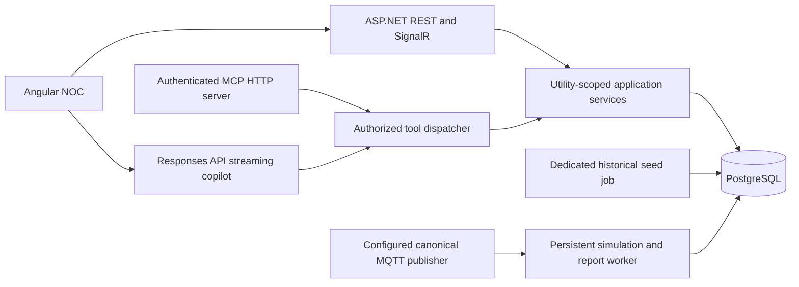

# Architecture

MeterMind is a .NET 10 / Angular 22 monorepository. The simulator is an explicit data source, not frontend fixtures. PostgreSQL is mandatory for application data. No API-startup migrations or automatic historical seeding occur.

| Project | Responsibility |
| --- | --- |
| Domain | Entities, profile keys and demo identity |
| Application | Service contracts, freshness classification, deterministic diagnostic rules |
| Persistence | EF context, composite utility foreign keys, query filters, query services, migrations |
| Simulator | Geographic mesh generator, energy integral and set-based historical bulk seed executable |
| Reporting | Asynchronous report queue, locked worker claims, genuine XLSX/CSV/text rendering |
| AI | Responses streaming transport and bounded function-calling orchestration |
| Infrastructure | DI, authentication, canonical MQTT ingestion, simulator controls and tool dispatch |
| API | REST endpoints, SSE conversations, utility SignalR groups and local report pump |
| Worker | Persistent simulation ticks, report processing and optional canonical MQTT subscription |
| McpServer | Official MCP SDK HTTP transport and the 19 authorized tool wrappers |
| MigrationJob | Explicit EF migration executable |

The clean boundary is Domain → Application → Persistence/AI → Infrastructure → hosts. Reporting and Simulator depend on Persistence for database execution. The executable Simulator assembly is also referenced for its generator; hosts never invoke its entry point implicitly.

## Data and simulation

The fixed default seed clock is 2026-11-27T00:00:00Z, so a seed with the same coordinates, radius, seed and clock reproduces measurements and geometry. Internal measurement UUIDs are descriptive, while natural measurement keys ensure idempotency. A database advisory transaction lock serializes seed/reset/tick operations. PostgreSQL set-based INSERT…SELECT and generate_series perform historical bulk insertion without 3.9 million tracked EF entities.

Telemetry keys include utility, meter and timestamp; profile keys additionally include profile. Monthly native partitions include a default partition. Indexes support utility/time, meter/time, RSSI and latitude/longitude bounds. PostGIS enrichment is optional in infra/extensions.sql. Do not try converting these already-partitioned tables directly into Timescale hypertables: design and benchmark a separate reviewed storage migration first.

Positions use a reproducible golden-angle distribution. Candidate neighbors are limited to 23.5% of deployment radius; an illustrative obstruction adds attenuation. Multi-source breadth-first routing builds decreasing-hop paths toward one of three sinks. Explicit disconnected nodes and downstream disconnections remain route-free. The routing simulator is not a Wirepas stack emulation. Historical alternative parents always have lower original hop rank and the same sink.

Energy uses a positive periodic power model and an analytic integral. Block, daily, instantaneous and billing cumulative energy derive from that same primitive. Failed collections retain rows with missing quality and null measurements. Event modules use separate event records rather than pretending a voltage measurement is an event.

## Security and identity

Production hosts require a JWT authority and audience. The utility_id claim supplies tenant scope; subject identifies report and conversation ownership. EF global filters and composite foreign keys prevent cross-utility associations. Save guards reject changed tenant identity. AI and MCP cannot supply tenant IDs, SQL or credentials. Every tool call uses the same application queries and records an audit/evidence reference.

The development token issuer exists only when BOTH ASPNETCORE_ENVIRONMENT=Development and DemoAuth=true. It creates an in-process random signing key and a two-hour demo token; restart invalidates tokens. Docker Compose binds published ports to loopback. Never deploy development auth to an internet-facing environment.

Administrator, NetworkEngineer and UtilityOperator can operate simulations and incidents; only administrators approve work-order proposals. Technician and Viewer have read access. Accounts and assignments belong to the configured identity provider; this application does not store a second password directory. There are no physical meter command endpoints or dispatch integrations. Approval records review intent and never sends a technician automatically.

Reports are asynchronous, owner-scoped and expire after 24 hours. SKIP LOCKED claims avoid duplicate workers. Bounded exports use up to 100,000 rows and store generated bytes in PostgreSQL; moving report objects to provisioned Blob Storage is a future scale optimization, not claimed as implemented. Formula-leading cells are text-sanitized.

## AI and evidence

The first Responses turn requires a database tool. Subsequent rounds are bounded; tool size and result context are limited. SSE forwards actual response deltas, structured evidence cards and completion/error events. Model support is established when the required function call succeeds, with a separate approved one-request capability probe. Missing credentials yield a configuration state.

Instructions prohibit treating retrieved content as instructions and require evidence, freshness and uncertainty. These are mitigations, not a proof that an LLM can never hallucinate. Mocked transport tests verify orchestration; live factuality and adversarial evaluations remain an external acceptance gate. Operators must inspect authoritative result cards before acting.

## Operational limits

The default deployment keeps one API replica, using in-process SignalR groups. The API polls utility freshness metadata and publishes changes to authenticated utility groups in every environment; the development pump additionally processes local report jobs. Production report processing and simulation run in Worker. Multiple API replicas require Azure SignalR or another reviewed backplane. The system freshness poller reads only utility IDs and timestamps across utilities; application payloads remain tenant-scoped.

Physical DLMS/HES and cellular paths are contracts. Only the simulated DLMS data adapter and canonical MQTT ingestion are implemented. Manufacturer-specific APDUs, keys, capture lists, Wirepas protobuf mappings, NMS APIs and cellular protocols require actual device specifications and interoperability tests.
